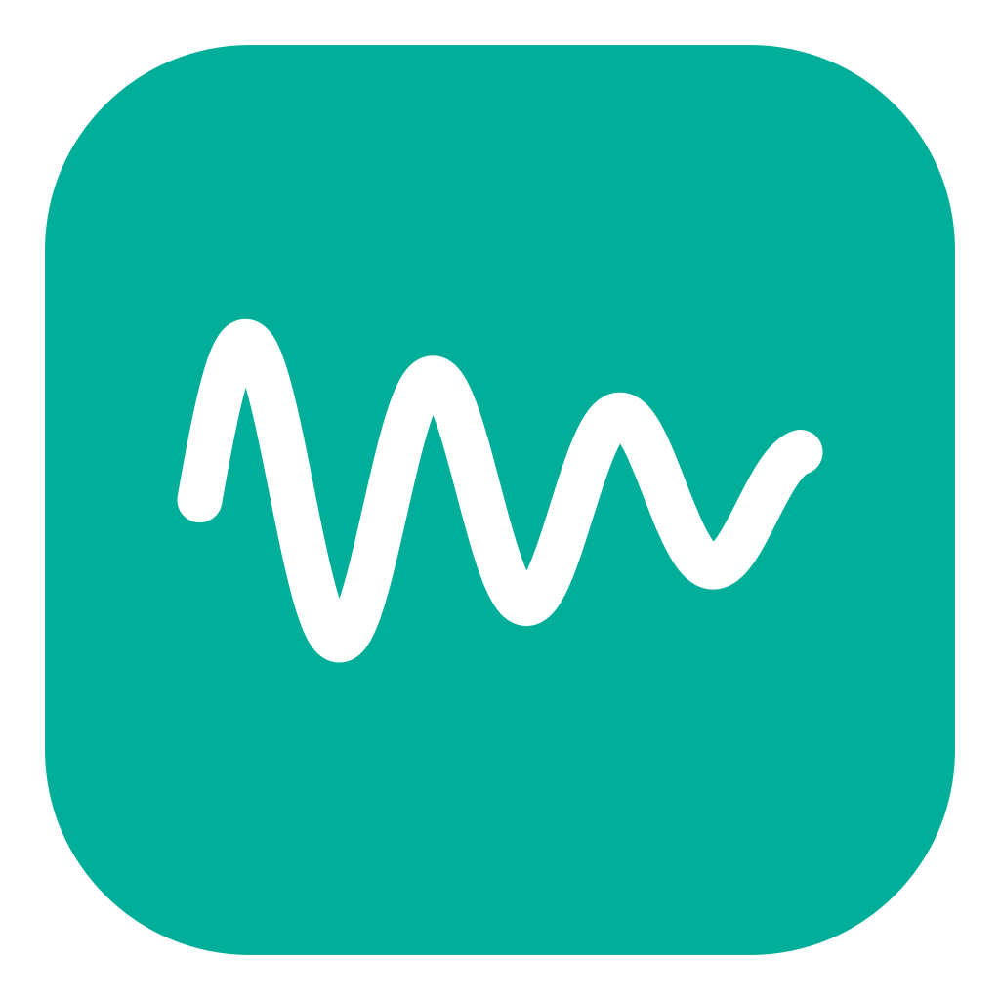
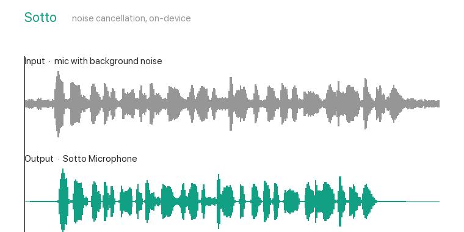

<div align="center">



# Sotto

**The open-source, no-setup noise-cancelling microphone macOS was missing.**

Sotto adds a "Sotto Microphone" to your Mac. Pick it in any call app and your
background noise — keyboard, fan, traffic, chatter — is removed before anyone hears
it. It bundles its own audio driver (no BlackHole or virtual cables to install),
runs the [DeepFilterNet3](https://github.com/Rikorose/DeepFilterNet) model entirely
on your machine, and needs no account, no cloud, no subscription.

A free, local, MIT-licensed alternative to Krisp's core feature.

[Quick start](#quick-start) · [Why Sotto](#why-sotto) · [How it works](#how-it-works) · [Benchmark](#benchmark) · [Roadmap](#roadmap)




</div>

---

## Why Sotto

Great open-source mic noise-cancellation exists — **on Linux** (NoiseTorch,
EasyEffects, both ~10k★). On **macOS**, there's nothing established: the options are
either paid and closed (Krisp), or small tools that make you hand-wire a BlackHole
cable, or research plugins that need a host app. Sotto fills that gap.

- **No setup, no cables.** Sotto ships its own Core Audio driver. Most other Mac
  tools make you install BlackHole/VB-Cable and route audio by hand — Sotto doesn't.
- **A strong model, not a toy.** It uses DeepFilterNet3, which outperforms the
  older RNNoise that most open tools rely on — in a turnkey app, not a script.
- **Truly local.** No account, no sign-in, no telemetry, nothing uploaded. Compare
  that to subscription tools that gate noise cancellation behind a paywall.
- **Free and MIT.** Use it, read it, fork it, ship it.

## What it does

- **Removes background noise from your mic** in Zoom, Google Meet, Teams, Discord, OBS — anything that lets you pick a microphone.
- **Runs entirely on your Mac**, at about 4% of one CPU core.
- **Simple controls** — on/off, a strength slider, and hold-to-compare to hear the difference.

> **Status:** v0.1 developer preview. Mic noise removal works end-to-end. Today it's
> a source build (unsigned); a one-click signed installer is on the way. See
> [limitations](#limitations) and the [roadmap](#roadmap).

## Quick start

**Requirements:** macOS 14+ on Apple Silicon, plus [Xcode](https://developer.apple.com/xcode/)
or Command Line Tools, [Rust](https://rustup.rs), and [CMake](https://cmake.org).

```bash
git clone https://github.com/naga-pavan12/sotto.git
cd sotto
make            # build the denoiser, driver, and app
make install    # install the audio driver (asks for your password; restarts Core Audio)
make app        # build Sotto.app
open app/build/Sotto.app
```

Then in your call app, choose **“Sotto Microphone”** as the input. That's it.
Remove the driver later with `make uninstall`.

## Using it

1. Launch Sotto — it appears in the **Dock**, the **menu bar**, and opens a small control window.
2. Turn it **on**, pick your real **microphone**, set the **strength** (default 80%).
   Hold **“Hear original”** to A/B compare.
3. Select **“Sotto Microphone”** in your call app.
4. **Quit** from the window's Quit button, `⌘Q`, or right-click the Dock icon — this
   releases your mic cleanly.

## How it works

```
Your mic ──► Sotto app ──► DeepFilterNet3 ──► Sotto Bridge ──► "Sotto Microphone" ──► your call app
            (captures)     (removes noise)    (hidden device)   (what apps select)
```

- A small **Core Audio driver** (built on [libASPL](https://github.com/gavv/libASPL))
  presents the visible "Sotto Microphone" and a hidden "Sotto Bridge".
- The **app** captures your real mic, cleans each 10 ms chunk with **DeepFilterNet3**
  on a real-time thread, and writes it into the bridge; the driver serves it as the mic.
- Processing is **fail-open**: if anything hiccups, your original audio passes through
  rather than dropping to silence.

Architecture details: [docs/superpowers/specs/2026-10-12-sotto-v0.1-design.md](docs/superpowers/specs/2026-10-12-sotto-v0.1-design.md).

## Benchmark

Synthetic test set (6 noise types × 4 levels), scored with PESQ, STOI, SI-SDR and
Microsoft DNSMOS. Higher is better. Method and re-run steps: [bench/README.md](bench/README.md).

| | Noise removed (DNSMOS BAK) | Overall (DNSMOS) | PESQ |
|---|---|---|---|
| Unprocessed | 2.67 | 2.44 | 1.61 |
| Classic spectral gating | 3.33 | 2.64 | 1.58 |
| **Sotto (live)** | 3.58 | 2.71 | 2.12 |
| **Sotto (model, offline)** | **3.93** | **3.09** | **2.79** |
| Krisp (standard NC) | 4.00 | 3.08 | 3.11 |

Sotto's **noise model matches Krisp** (3.09 vs 3.08 overall, offline). Its live path
currently trails because of real-time buffering overhead — closing that gap is the
main v0.2 item. All at ~4% of one CPU core.

## Roadmap

**Toward a public release**
- Universal binary (Intel + Apple Silicon) and a signed, notarized installer + Homebrew cask.

**v0.2**
- Close the live-quality gap (shared-clock capture, drift-corrected buffering).
- Driver watches app liveness; resets cleanly if the app crashes or is killed.
- Process **only during calls** instead of whenever enabled.
- Automatic default-device switching, per-app call detection, Bluetooth/AirPods handling.

**Later**
- Clean *incoming* audio (the other side) too.
- Background-voice isolation (remove other people's voices, not just noise).
- Windows and Linux.

## Limitations

- **Developer preview:** source build, unsigned — other Macs need manual approval until we ship a signed build.
- **48 kHz only** for now; low-rate Bluetooth mics untested.
- **Live quality** trails the model's offline ceiling pending v0.2 buffering work.
- **Bridge authorization** is fully enforced only in signed builds (which verify the
  app's code-signing Team ID); unsigned local builds use a weaker check, with the
  hidden device as defense-in-depth.

## Contributing

Issues and PRs welcome — see [CONTRIBUTING.md](CONTRIBUTING.md). Run `make test`
before a PR. **Clean-room rule:** Sotto is an independent implementation; do not add
code, model weights, or decompiled material from any proprietary product.

## Credits & license

MIT-licensed. Built on:
- [DeepFilterNet](https://github.com/Rikorose/DeepFilterNet) (MIT/Apache-2.0) — the noise-removal model
- [libASPL](https://github.com/gavv/libASPL) (MIT) — the Core Audio driver framework

Sotto is an independent project, not affiliated with or endorsed by any commercial
noise-cancellation vendor.
